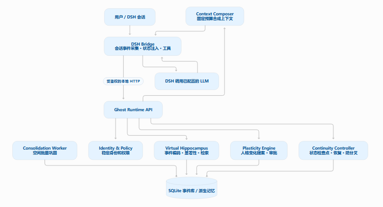

# DSH / DeepSeek Harness Agent-Ghost

**Ghost 0.2.0 · 中文 / English**

Ghost 用持久身份、记忆与 LLM 串联不同对话中的经历，构建一个逐渐成长的虚拟人格。对话窗口可以改变，延续的仍是同一个 Ghost。

### 基本构想

源自《Ghost：总体工程设计说明 v0.2》：**DSH 负责交流，Ghost 保存自我与经历，LLM 提供当下的理解和表达。** 虚拟海马体连接事件、关注点与回忆；人格随长期交流形成，影响哪些事情更值得记住。状态连续性让重启后的 Ghost 能延续已保存的自己。

记忆逐渐变模糊：**15 天内强化细节，16–60 天保留概要与重点，超过 60 天压缩为梗概**，同时留下少量详细的关注瞬间，类似快照。回忆时将当前人格带入过去的情境，从梗概和快照推演可能的经过与问题。

可以记不清，但要保留“曾有这段经历记录”的锚点。私人回忆允许模糊补全，补全是推演；公共事件的具体事实必须依据可靠来源核验。虚构、梦境和模型说法不会因此变成真实发生过的事。

整体保持黑盒：通过交流慢慢形成细节，只需启动或关闭。这里的“连续”指身份、记忆和软件状态的延续，不等于已证明具有主观意识。

### The idea

Based on *Ghost: Overall Engineering Design v0.2*: **DSH provides conversation, Ghost preserves identity and experience, and an LLM provides understanding and expression in the moment.** A virtual hippocampus connects events, attention and recall. Personality develops through long-term conversation and shapes what matters. Persistent state lets Ghost resume its saved self across conversations and restarts.

Memory gradually becomes less detailed: **reinforced detail for 15 days, summaries and key points through day 60, then compressed gist**, with a few detailed moments of attention preserved as snapshots. Recall brings the current personality into a past situation, using its gist and snapshots to simulate possible circumstances and problems.

Details may fade, while an anchor preserves that the experience was recorded. Private recollections may include clearly distinguished reconstruction. Specific public facts require reliable verification. Fiction, dreams and model output do not become real events merely by being remembered.

Ghost remains a black box: its details grow through conversation, with only a start/stop control for everyday use. Continuity means persistent identity, memory and software state; it is not proof of subjective consciousness.
